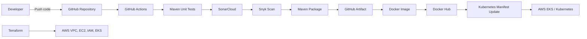
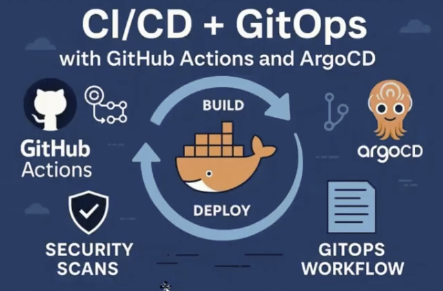
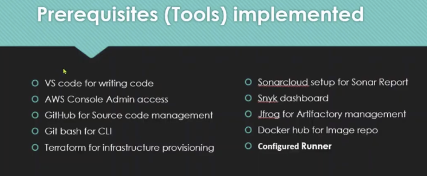
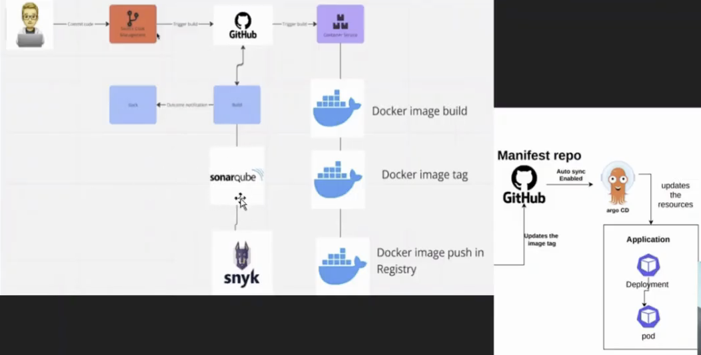

# DevSecOps CI/CD Pipeline with GitHub Actions | Terraform, Docker, ArgoCD & AWS EKS

An end-to-end DevSecOps project that builds and tests a Java Spring PetClinic application, performs code and dependency security scans, packages it in Docker, and prepares AWS and Kubernetes infrastructure for deployment.

> This repository currently uses GitHub Actions for CI/CD, Docker for application packaging, Terraform for AWS infrastructure, and Kubernetes manifests for workload deployment. ArgoCD is the recommended GitOps deployment pattern; dedicated ArgoCD manifests are not yet included.

## Table of Contents

- [Architecture](#architecture)
- [Application](#application)
- [Pipeline](#pipeline)
- [Repository Structure](#repository-structure)
- [Prerequisites](#prerequisites)
- [Local Development](#local-development)
- [Docker](#docker)
- [AWS Infrastructure](#aws-infrastructure)
- [Kubernetes Deployment](#kubernetes-deployment)
- [GitHub Actions Secrets](#github-actions-secrets)
- [Security](#security)
- [Current Deployment Status](#current-deployment-status)
- [Future Improvements](#future-improvements)

## Architecture



<p align="center">
  
</p>

<p align="center">
  
</p>

<p align="center">
  
</p>

## Application

- Spring Boot 3.2 application
- Java 17
- Maven build system
- Spring PetClinic sample application
- H2 database by default, with MySQL and PostgreSQL configurations available
- Exposes HTTP on container port `8080`

## Pipeline

The reusable workflow [ci.yaml](Devsecops-cicd-pipeline/.github/workflows/ci.yaml) runs on pushes to `main` and performs the following stages:

1. Run Maven unit tests.
2. Scan source code with SonarCloud.
3. Scan Maven dependencies with Snyk.
4. Package the JAR and upload it as a GitHub Actions artifact.
5. Download the JAR, build a Docker image, and tag it with the Git commit SHA.
6. Push the image to Docker Hub.
7. Update [kubernetes/deployment.yaml](Devsecops-cicd-pipeline/kubernetes/deployment.yaml) with the new image tag.
8. Commit and push the manifest change.

The JFrog upload, EC2 Docker deployment, AWS connection, and direct EKS deployment jobs are available as reusable workflows but are currently disabled in the main `ci.yaml` pipeline.

## Repository Structure

```text
.
├── README.md
└── Devsecops-cicd-pipeline/
    ├── .github/workflows/       # CI/CD reusable workflows
    ├── src/                      # Spring PetClinic source and tests
    ├── kubernates/               # Kubernetes deployment and service manifests
    ├── kubernetes/               # Updated image manifest used by Docker push job
    ├── terraform-code/           # AWS VPC, IAM, EC2, and EKS modules
    ├── docs/images/              # Architecture diagrams
    ├── Dockerfile
    ├── pom.xml
    └── aws-auth.yaml
```

## Prerequisites

- Java 17
- Maven 3.x
- Docker
- Terraform 1.x
- AWS CLI
- `kubectl`
- GitHub Actions runner (the workflows currently use `self-hosted`)
- Docker Hub account
- SonarCloud and Snyk accounts

## Local Development

```bash
cd Devsecops-cicd-pipeline
mvn test
mvn spring-boot:run
```

The application is available at `http://localhost:8080` by default.

To create the application package:

```bash
mvn clean package -DskipTests
```

## Docker

Build the image from the application directory:

```bash
cd Devsecops-cicd-pipeline
mvn clean package -DskipTests
docker build -t petclinic:local .
docker run --rm -p 8080:8080 petclinic:local
```

Open `http://localhost:8080`.

The Docker image uses Eclipse Temurin 17 JRE and runs the JAR at `/app/petclinic.jar`.

## AWS Infrastructure

Terraform configuration is located in [terraform-code](Devsecops-cicd-pipeline/terraform-code).

It can provision:

- A VPC and public/private subnets
- Internet gateway and route table configuration
- Security groups
- An EC2 web server
- IAM roles
- EKS cluster and managed node-group modules
- An IAM CI/CD user

The AWS provider region is `ap-northeast-3`, and the EKS cluster modules are included but disabled in [main.tf](Devsecops-cicd-pipeline/terraform-code/main.tf).

Initialize and review the infrastructure plan:

```bash
cd Devsecops-cicd-pipeline/terraform-code
terraform init
terraform fmt -recursive
terraform validate
terraform plan
```

Apply only after reviewing `terraform.tfvars` and the AWS account-specific resource names:

```bash
terraform apply
```

> Review credentials and resource values before deployment. The Terraform configuration contains environment-specific values such as region, AMI, key pair, VPC CIDR, and IAM policy settings.

## Kubernetes Deployment

The [kubernetes](Devsecops-cicd-pipeline/kubernetes) directory contains a Deployment with two replicas and a LoadBalancer Service. The corresponding [kubernates](Devsecops-cicd-pipeline/kubernates) directory contains the alternate manifest set used by the direct EKS workflow.

After configuring `kubectl` for an EKS cluster:

```bash
kubectl apply -f Devsecops-cicd-pipeline/kubernetes/deployment.yaml
kubectl apply -f Devsecops-cicd-pipeline/kubernetes/service.yaml
kubectl rollout status deployment/myapp-deployment
kubectl get pods
kubectl get services
```

## GitHub Actions Secrets

Configure the following repository secrets for the enabled workflows:

| Secret | Used by |
|---|---|
| `DOCKERHUB_USERNAME` | Docker image repository |
| `DOCKERHUB_TOKEN` | Docker Hub authentication |
| `SONAR_TOKEN` | SonarCloud authentication |
| `SNYK_TOKEN` | Snyk authentication |

Additional secrets are required only when enabling the EC2 or EKS workflows:

| Secret | Purpose |
|---|---|
| `IAM_ACCESS_KEY` | AWS access key |
| `IAM_SECRET_KEY` | AWS secret access key |
| `AWS_REGION` | AWS region |
| `EKS_CLUSTER_NAME` | Target EKS cluster |
| `EC2_PUBLIC_IP` | EC2 deployment host |
| `EC2_SSH_KEY` | SSH private key |

Use GitHub Actions secrets or an organization-secret policy for credentials. Do not commit API keys or private keys.

## Security

This project includes multiple security-focused stages:

- Maven unit tests
- SonarCloud static code analysis
- Snyk dependency scanning
- Docker image-based application packaging
- AWS security groups and IAM role configuration
- Kubernetes Service isolation through labels and selectors

The main Snyk dependency scan currently logs findings and continues for a dependency test failure. Enable `snyk test --severity-threshold=...` with a desired policy threshold before production use.

## Current Deployment Status

The active CI path:

```text
Push to main
  -> Unit tests
  -> SonarCloud
  -> Snyk
  -> Maven package
  -> Docker build
  -> Docker Hub push
  -> Kubernetes manifest update
```

Direct EC2 and EKS deployment jobs are intentionally commented out in the main pipeline until AWS credentials, cluster infrastructure, and deployment policies are configured.

## Future Improvements

- Complete the Terraform-managed EKS cluster and node group deployment.
- Enable direct or ArgoCD-based Kubernetes deployment.
- Add Trivy container and Terraform/IaC image scanning.
- Use GitHub OIDC instead of long-lived AWS access keys.
- Add a dedicated Helm chart or Kustomize overlay.
- Add Kubernetes health probes and resource limits.
- Configure a private container registry and image signing.
- Implement branch protection and environment approvals.
- Add Sonar, Snyk, and container scan quality gates.
